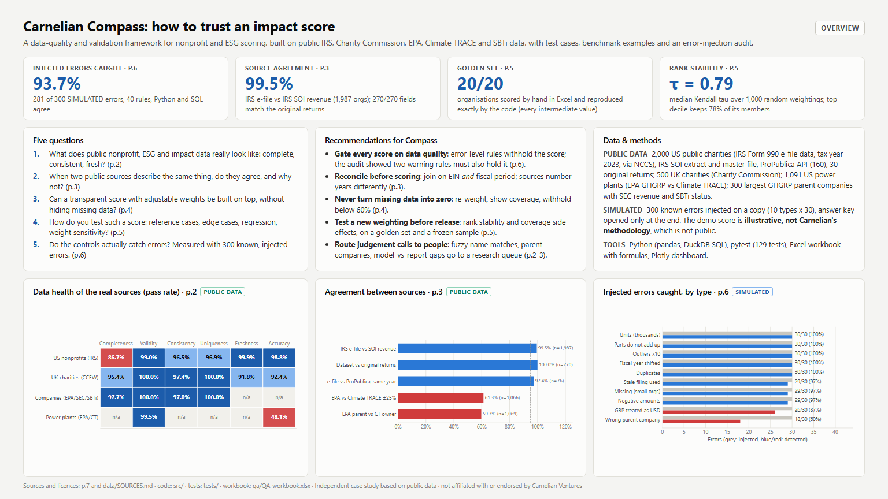

# Carnelian Compass: how to trust an impact score

**A data-quality and validation framework for nonprofit and ESG scoring, built on public IRS, Charity Commission, EPA,
Climate TRACE and SBTi data, with test cases, benchmark examples and an error-injection audit.**

*Independent case study based on public data · not affiliated with or endorsed by Carnelian Ventures.*

Carnelian Ventures describes Compass as an impact intelligence platform that connects investment and giving portfolios,
normalises the data and computes comparable ESG and impact scores, with adjustable metrics and weights and nonprofit scoring
(as stated by Carnelian on its website, seen on 16 November 2026). A comparable score is only as good as the data and the
checks behind it. This study does the Data & QA work on public data: audit the inputs, build a transparent demo score,
test it, and measure whether the controls catch known errors.

| Deliverable | Where |
|---|---|
| 8-page report (PDF) | [`docs/Carnelian_Compass_impact_data_QA_case_study.pdf`](docs/Carnelian_Compass_impact_data_QA_case_study.pdf) |
| Data quality cockpit (stand-alone HTML, 4 tabs) | [`dashboard/data_quality_cockpit.html`](dashboard/data_quality_cockpit.html) |
| QA workbook (rules, issues log, golden set, manual check, detection; formulas only) | [`qa/QA_workbook.xlsx`](qa/QA_workbook.xlsx) · [`qa/issues_log.xlsx`](qa/issues_log.xlsx) |
| Notebook | [`notebooks/carnelian_compass_qa.ipynb`](notebooks/carnelian_compass_qa.ipynb) |
| Standards, methodology, sources | [`docs/DATA_STANDARDS.md`](docs/DATA_STANDARDS.md) · [`docs/METHODOLOGY.md`](docs/METHODOLOGY.md) · [`data/SOURCES.md`](data/SOURCES.md) |



## Four key results

1. **The checks caught 281 of 300 injected errors (93.7%)**, with 100% precision on the new alerts. The misses point to rules
   that compare names instead of IDs (wrong parent company: 18/30, 9 of the 12 misses hiding behind an alert already open on
   the real data) and to fields that cannot be checked when a value is zero
   or a date is missing. *(SIMULATED errors on real records.)*
2. **Copies of the same IRS filing agree 99.5% of the time; every gap sits on an amended return.** 30 of 30 sampled returns
   match the original e-filed Form 990 on all 9 fields. Modelled and reported emissions agree within 25% for only 61% of
   1,066 US power plants (EPA GHGRP vs Climate TRACE). *(PUBLIC DATA.)*
3. **The demo score is reproducible and tested**: 20 organisations scored by hand in Excel are reproduced exactly by the code
   (520 intermediate values), plus edge cases, 150 frozen regression scores and 129 passing tests. Rankings are fairly stable
   under 1,000 random weightings (median Kendall tau 0.79), but raising one weight by 50% silently removed 183 company scores
   through the coverage threshold: the kind of side effect to test before releasing a new weighting.
4. **The error audit changed the process**: with an errors-only gate, 15 of 20 company errors still moved a published rank by
   more than 10 points; holding scores on two warning rules (gate v2) brought that to 0.

## Methods

- **Data (PUBLIC DATA)**: 2,000 US 501(c)(3) public charities (500 per size band; IRS Form 990 e-file data for tax year 2023
  via NCCS), cross-checked with the IRS SOI extract, the IRS master file, the ProPublica API (160) and 30 original returns;
  500 UK charities (Charity Commission); 1,091 US power plants (EPA GHGRP vs Climate TRACE); the 300 largest GHGRP parent
  companies with SEC revenue and SBTi status. Person-level fields are never read.
- **Data-quality framework**: 40 rules over six dimensions (completeness, validity, consistency, uniqueness, freshness,
  accuracy) in [`src/dq/rules.yaml`](src/dq/rules.yaml), executed in pandas and in DuckDB SQL (must agree); issues log with
  status, decision and research need; reconciliation between sources; fuzzy name matches reviewed by hand
  ([`data/processed/match_review.csv`](data/processed/match_review.csv)).
- **Demo score** (illustrative, not Carnelian's methodology): financial health, efficiency, stability and transparency for
  nonprofits; carbon intensity, trend, SBTi target and disclosure for companies; peer-group percentiles, caps, explicit
  missing-data handling (re-weighting, 60% coverage minimum, never zero), data-quality gate. Weights in
  [`src/scoring/config.yaml`](src/scoring/config.yaml).
- **Tests** (pytest): one per rule and engine, scoring units, golden set, edge cases, non-regression, robustness;
  coverage of the rule and scoring engines in [`docs/test_coverage.txt`](docs/test_coverage.txt).
- **Error injection (SIMULATED)**: 300 errors, 10 types (units, signs, sums, duplicates, shifted fiscal years, missing values
  in small organisations, x10 outliers, wrong parent company, GBP read as USD, stale filings), seed 42; answer key in
  [`data/_hidden_truth.csv`](data/_hidden_truth.csv), opened only after the checks ran.
- **AI-assisted workflow**: I used Claude, mainly to write scripts faster. I drove the project: I defined the questions, chose and validated the data sources, made the analytical decisions and checked every result.

## How to rerun

Python 3.13, Microsoft Edge (PDF and screenshots). LibreOffice is needed only to regenerate the golden set.

```bash
python -m venv .venv && .venv/Scripts/activate      # Windows; use .venv/bin/activate elsewhere
pip install -r requirements.txt
python src/download_data.py          # public sources -> data/raw/ (about 600 MB, cached)
python src/build_processed.py        # filtered extracts -> data/processed/
python src/fetch_samples.py          # ProPublica sample + 30 original returns
python src/prepare.py                # analysis tables
python src/inject_errors.py          # SIMULATED errors + answer key
python src/run_checks.py             # 40 rules, Python and SQL
python src/evaluate_detection.py     # recall / precision by error type
python src/reconcile.py              # source agreement
python src/robustness.py             # weights, coverage, effect of errors
pytest                               # all tests
python src/build_excel.py            # qa/QA_workbook.xlsx, qa/issues_log.xlsx
python src/build_notebook.py         # executes the notebook
python src/build_dashboard.py        # dashboard/data_quality_cockpit.html
python src/build_pdf.py              # docs/*.pdf
```

Or everything in order: `python src/run_all.py` (`--skip-download` to reuse `data/raw/`). SQL versions of the rules and of the
reconciliation: [`sql/dq_rules.sql`](sql/dq_rules.sql), [`sql/reconciliation.sql`](sql/reconciliation.sql).

## Sources and licences

IRS SOI extract and Business Master File (public domain) · IRS Form 990 e-file data via NCCS / Urban Institute and the
GivingTuesday data lake · ProPublica Nonprofit Explorer API (CC BY-NC-ND 3.0 US: used for comparison only, values not
republished) · Charity Commission register (Open Government Licence v3.0) · EPA GHGRP via Envirofacts (public domain) ·
Climate TRACE (CC BY 4.0) · SBTi Target Dashboard (raw file not redistributed) · SEC EDGAR XBRL frames · Carnelian Ventures
website (published facts only). Details, dates and terms: [`data/SOURCES.md`](data/SOURCES.md).

## Limits

- Detection rates measure the rules on SIMULATED errors, not the quality of any source.
- The demo score is illustrative and relative to this sample; it is not a ranking to use for giving or investing, and no
  organisation is named in the report. A financial ratio is not an impact measure; a low overhead share is not always good;
  direct emissions do not tell the whole story of a company's impact.
- Sample sizes are modest (2,000 US charities with equal size bands, 500 UK charities, 300 companies, US direct emissions only).
- The 30-return check reads the original XML by script, value by value; the links are in the workbook for a human spot-check.
